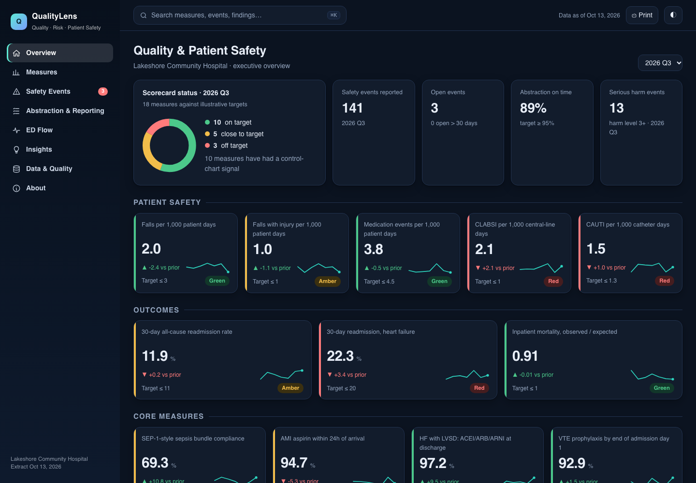
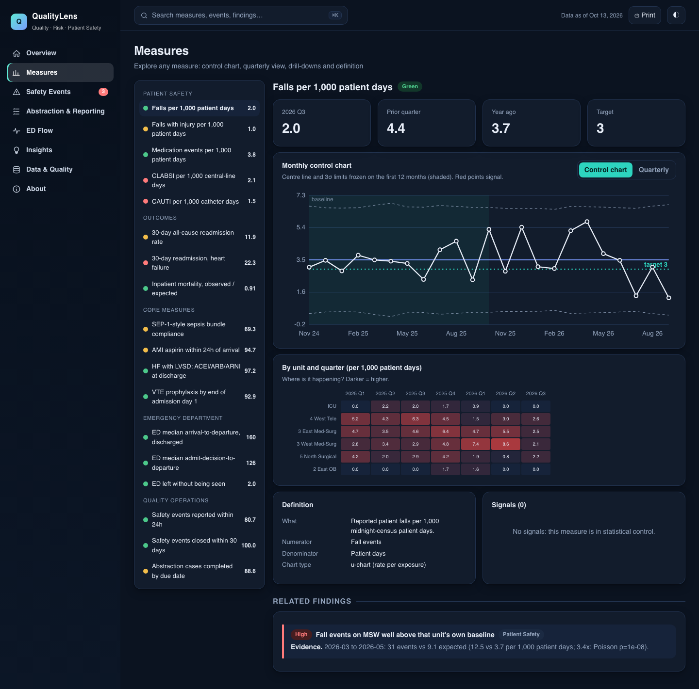
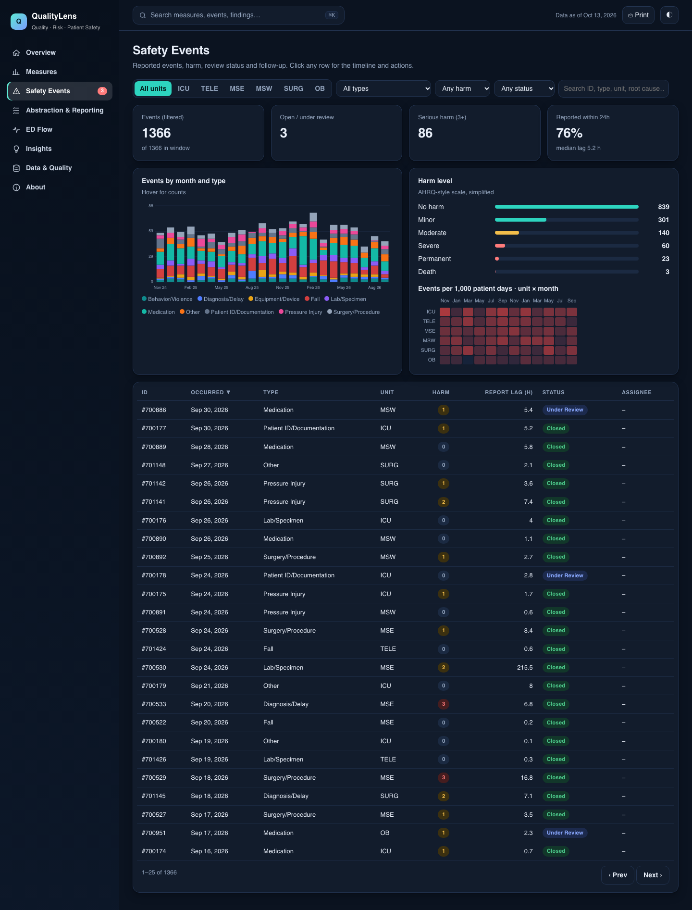
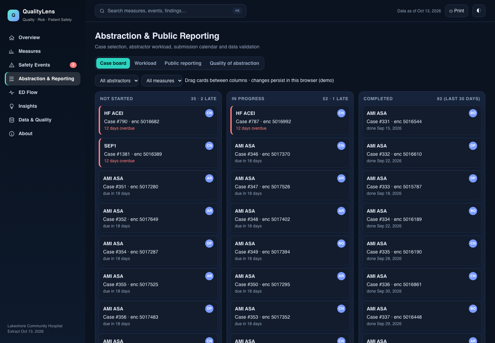
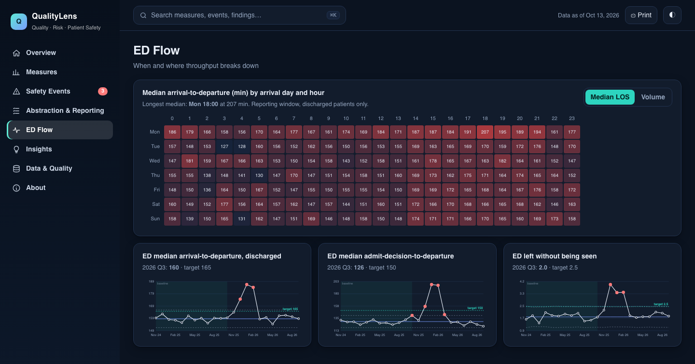

# Acute Care Quality & Patient Safety Reporting Pack

I built this end-to-end quality-reporting system for a fictional 124-bed community hospital to practise how a hospital quality team turns raw operational data into **trusted committee reports**: scorecards, control charts, safety-event tracking, chart-abstraction workflow and public-reporting status.

## QualityLens web app

Open `app/index.html` (double-click; no server or install needed). I wrote it as a multi-page command center in plain HTML/CSS/JS with hand-written SVG charts: executive overview with RAG tiles, measure explorer (control charts, unit heatmaps, definitions), safety-event workbench (filters, sort, timeline drawer, assign/close actions), abstraction case board (drag-and-drop), submission calendar, ED day-by-hour heatmap, generated insights, data-quality view, command palette (Cmd/Ctrl+K), dark mode and print. Demo actions are saved only in your browser. Data is exported by `make app` (`src/qsr/export_app_data.py`).

## Screenshots

| Overview | Measure explorer |
|---|---|
|  |  |
| **Safety events** | **Abstraction board** |
|  |  |



## What it produces

| Deliverable | File | Audience |
|---|---|---|
| Interactive HTML dashboard (scorecard, findings, 18 control charts, drill-downs, trackers) | `outputs/dashboard.html` | Quality & Safety Committee |
| Excel committee pack (RAG scorecard with sparklines, native control charts, trackers, definitions) | `outputs/Quality_Committee_Pack.xlsx` | Quality staff, leadership |
| PDF brief (scorecard, findings, control charts, abstraction status) | `outputs/Quality_Brief.pdf` | Medical Executive Committee / Board |
| Cleaning log, SPC series, scorecard CSVs | `outputs/*.csv` | Analysts |

## Pipeline

```
generate_data.py ─► data/raw/*.csv ─► staging.py ─► data/quality.db ─► sql/measures/*.sql ─► measures.py (+spc.py, mortality.py)
 (seeded, plants                      (10 documented     (SQLite)        (views, SQL-first)          │
  signals + defects)                   cleaning rules,                                               ▼
                                       every fix logged)                 findings.py ─► report_html / report_excel / report_pdf
```

1. **I generate** 24 months of data: 17.8k inpatient encounters, 82k ED visits, 1.4k safety events, 14.6k measure-population rows, 2k abstraction cases.
2. **I clean** the data with 10 documented rules. I injected raw defects on purpose (duplicates, swapped dates, unit-code typos, missing timestamps, impossible ages); the cleaning step must find *exactly* the injected counts, and a test checks that.
3. **I measure** in SQL views (window functions for medians, correlated `EXISTS` for readmissions), using midnight-census patient days and device days as denominators.
4. **I monitor** with p-, u- and XmR control charts on a frozen 12-month baseline, plus Nelson-style shift and trend rules.
5. **I explain**: a findings engine I wrote scans for statistically unusual unit/event combinations (Poisson tail tests), drills into drivers (e.g., which sepsis-bundle element failed) and turns the evidence into plain-language findings with suggested actions.
6. **I publish** the HTML, Excel and PDF outputs.

## Measures (18 on the scorecard)

Patient safety (falls, falls with injury, medication events, CLABSI, CAUTI) · Outcomes (30-day readmission overall and HF, risk-adjusted mortality O/E) · Core-measure-style process measures (sepsis bundle, AMI aspirin, HF ACEI/ARB/ARNI, VTE prophylaxis) · ED (median LOS, boarding, left-without-being-seen) · Quality operations (event reporting timeliness, event closure, abstraction on-time rate). Definitions: [docs/measure_specs.md](docs/measure_specs.md).

## Quality-department workflows modelled

- **Safety-event management:** reporting lag, harm level, review/closure, open-event aging, root-cause categories.
- **Case selection and abstraction tracking:** monthly sampling per measure, assignment to four abstractors, due dates, overdue cases, workload, backlog detection.
- **Data validation:** abstracted vs EHR-derived agreement and second-review inter-rater agreement (Cohen's kappa).
- **Public-reporting calendar:** quarterly submission log with due dates, late and not-yet-due status.

## Run it

```bash
python3 -m venv .venv && .venv/bin/pip install -r requirements.txt
make all          # data → database → reports → data dictionary → tests
open outputs/dashboard.html
```

## Testing (30 tests)

- **Independent recomputation:** every SQL measure (readmissions, falls, medication events, infections, ED medians, LWBS, core measures, event timeliness, abstraction on-time) is recalculated in pandas from the clean tables and compared to 1e-9. I deliberately broke the readmission SQL to confirm the suite fails.
- **Cleaning vs ground truth:** rows flagged by each rule equal the defects injected, with no defects left behind; referential integrity checks.
- **SPC unit tests:** known control limits, 3-sigma breach, 7-vs-8-point shift boundary, trend rule, XmR limits.
- **Statistics:** Cohen's kappa on known cases; RAG boundary tests; mortality model calibrated on its baseline.
- **Detection tests:** the pipeline must rediscover the planted signals without being told where they are.
- **Report tests:** dashboard, workbook (sheets, native charts) and PDF are produced with the expected content.

## What the data says (scenarios I planted that the pipeline rediscovers)

Fall events on one med-surg unit tripled for three months (31 vs 9.1 expected); a weekend VTE-prophylaxis gap on the same unit (79% vs 93%); a sepsis-bundle dip driven by the repeat-lactate element; a January medication-event spike above the control limit; an HF readmission peak; a winter ED surge (boarding, LOS and LWBS); an abstraction backlog (on-time rate fell to 38%); and one late public-reporting submission. Full narrative: [docs/case_study.md](docs/case_study.md).

## Limitations (read these)

- Synthetic data cannot show real-world messiness, true causal drivers or real benchmark performance. I planted the "signals" in the generator, so detecting them demonstrates my method, not a real discovery.
- Measure specifications are simplified; real CORE/eCQM measures have many more inclusion, exclusion and timing rules.
- Mortality O/E uses a simple logistic model, not a validated risk-adjustment model.
- Small-denominator measures (infections, AMI) are volatile; the control charts and p-values are there to avoid over-reading single months.
- No PHI handling, access control or audit trail is implemented here; a production system would need all three.

## Data and disclosures

**All data is synthetic.** No real hospital, patient or result is represented. Targets are illustrative internal targets, not national benchmarks. Measure logic is simplified and modelled on public quality-measure concepts (readmissions, sepsis bundle, AMI/HF/VTE process measures, CLABSI/CAUTI, ED throughput); it is **not** an official Joint Commission or CMS specification. I modelled the *functions* of quality and risk-management platforms, but I did not build on, and make no claim about, any specific vendor product.
